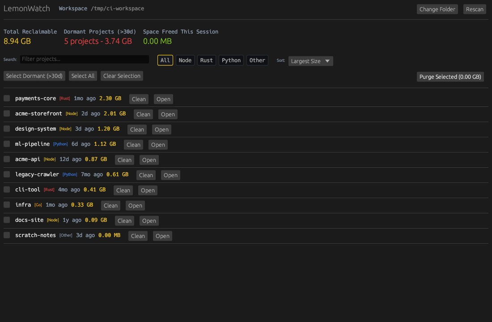

# LemonWatch


**LemonWatch** (`lemon-watch`) is a fast, native desktop GUI application for scanning dev workspaces and reclaiming disk space from stale build caches. Built as the second micro-utility in the **LLAStudio LEMON** series: instant startup, zero configuration, single lightweight binary.


## Screenshots

- **Header:** Workspace path + Change Folder / Rescan buttons.
- **KPI cards:** Total Reclaimable (Lemon Yellow), Dormant Projects >30d (Coral), Space Freed This Session (Lime).
- **Filter bar:** Live search, ecosystem pills (All / Node / Rust / Python / Other), sort dropdown, Select Dormant / Select All / Clear Selection, Purge Selected.
- **Project list:** Checkbox, project name, ecosystem badge, last-active badge, cache tags, size, Clean + Open buttons.
- **Confirmation modal:** Lists exact folders and total GB before deletion.
- **Progress modal:** Real-time progress bar + toast notifications.

## Features

- **Multi-threaded workspace scanner** — `rayon`-parallel project discovery, cache detection, size computation, and last-active calculation without blocking the GUI.
- **Project markers** — Recognizes `package.json`, `Cargo.toml`, `pyproject.toml`, `go.mod`, `composer.json`, `.git`.
- **Cache whitelist** — Safe purge of `node_modules`, `.next`, `.nuxt`, `target`, `.venv`, `__pycache__`, `vendor`, and more.
- **No nested cache descent** — Stops at matched cache dirs; never scans nested projects inside them.
- **Inactivity labels** — Human-readable "2h ago", "45d ago", "6mo ago" from real source-file mtime.
- **Non-blocking GUI** — 60 FPS background scan via `std::sync::mpsc`, live project discovery and reclaimable GB updates.
- **Strict deletion guardrails** — Verifies target dir name is in the whitelist AND sits beside a project marker before deleting.
- **CLI headless mode** — `--dry-run` and `--json` flags via `clap`.

## Screenshot



## Installation

### Pre-built binaries

Download the latest release for your platform from [GitHub Releases](https://github.com/LLAStudio/LemonWatch/releases):

| Platform | Archive |
|---|---|
| Linux (x86_64) | `lemon-watch-1.0.0-linux-x86_64.AppImage` |
| Linux (Flatpak) | `lemon-watch-1.0.0-x86_64.flatpak` |
| Windows | `lemon-watch-1.0.0-win-x64.exe` (portable), `.msi`, `.setup.exe` |
| macOS (Universal) | `lemon-watch-1.0.0-mac-universal.app.zip`, `.dmg` |

**Linux (AppImage):**
```bash
chmod +x lemon-watch-1.0.0-linux-x86_64.AppImage
./lemon-watch-1.0.0-linux-x86_64.AppImage
```

**Linux (Flatpak):**
```bash
flatpak install --user lemon-watch-1.0.0-x86_64.flatpak
flatpak run dev.llastudio.lemon-watch
```

**Windows:**
- Run `lemon-watch-1.0.0-win-x64-setup.exe` or `lemon-watch-1.0.0-win-x64.msi` to install, or use the portable `.exe`.
- SmartScreen may show "More info -> Run anyway" for unsigned binaries. This is expected.

**macOS:**
- Open `lemon-watch-1.0.0-mac-universal.dmg` and drag to Applications, or unzip `.app.zip` and place in `/Applications`.
- For unsigned builds, run: `xattr -dr com.apple.quarantine /Applications/LemonWatch.app`

### Verify checksums

```bash
# Linux / macOS
sha256sum -c SHA256SUMS

# Windows PowerShell
Get-FileHash lemon-watch-1.0.0-win-x64.exe -Algorithm SHA256
```

### From source (Cargo)

```bash
cargo install --git https://github.com/LLAStudio/LemonWatch
```

### Run from source

```bash
git clone https://github.com/LLAStudio/LemonWatch
cd LemonWatch
cargo run -- ~/dev
```

## CLI Usage

Open the GUI (default):
```bash
lemon-watch
```

Open with a workspace path:
```bash
lemon-watch ~/dev
```

Headless dry-run (print cache sizes, no GUI):
```bash
lemon-watch --dry-run ~/dev
```

JSON export (no GUI):
```bash
lemon-watch --json ~/dev
```

## Building from source

### Requirements

- Rust 1.100+ (or the MSRV specified in `rust-toolchain.toml` if present)
- For macOS: Xcode CLT or equivalent
- For Windows: MSVC build tools or GNU toolchain
- For Linux AppImage: `appimagetool`
- For Flatpak: `flatpak-builder`, `flatpak`
- For Windows MSI/Setup: `makensis` (NSIS), WiX toolset (optional for `.msi`)

### Steps

```bash
git clone https://github.com/LLAStudio/LemonWatch
cd LemonWatch
cargo build --release
```

The binary lands in `target/release/lemon-watch`.

### Cross-compilation notes

- **Windows (mingw):** `cargo build --release --target x86_64-pc-windows-msvc` (MSVC) or `x86_64-pc-windows-gnu`.
- **macOS universal:** build `x86_64-apple-darwin` and `aarch64-apple-darwin`, then `lipo -create -output LemonWatch target/.../lemon-watch target/.../lemon-watch`.
- **Linux AppImage:** bundle with `appimagetool` against an x86_64 glibc box.
- **Flatpak:** use the manifest `dev.llastudio.lemon-watch.yml` with `flatpak-builder`.

## Packaging & Releases

Pushing a Git tag `v*` triggers the GitHub Actions release workflow.

### Tag a release

```bash
git add .
git commit -m "chore: prepare v1.0.0 release"
git tag v1.0.0
git push origin main --tags
```

### Artifacts produced by the release workflow

- `lemon-watch-<version>-win-x64.exe` (portable)
- `lemon-watch-<version>-win-x64.msi`
- `lemon-watch-Setup-<version>.exe` (NSIS)
- `lemon-watch-<version>-mac-universal.app.zip`
- `lemon-watch-<version>-mac-universal.dmg`
- `lemon-watch-<version>-linux-x86_64.AppImage`
- `lemon-watch-<version>-x86_64.flatpak`
- `SHA256SUMS`

## Development

```bash
cargo check
cargo test
cargo run
```

### Icon generation

Icons are stored in `assets/`. To regenerate:

- `icon.png` — 512x512 lemon/lime branded PNG.
- `icon.ico` — Windows icon (multi-resolution).
- `icon.icns` — macOS icon set.

Use `scripts/make-icons.py` (Python + Pillow) or `scripts/make-icons.rs` (pure Rust) from the repo if you need to rebuild them.

## License

MIT — see [LICENSE](LICENSE).

## Credits

Built by [LLAStudio](https://github.com/LLAStudio) as part of the **LEMON** micro-utility series.

Crates used: `eframe`, `egui`, `rfd`, `walkdir`, `rayon`, `open`, `clap`, `serde`, `serde_json`, `anyhow`.
